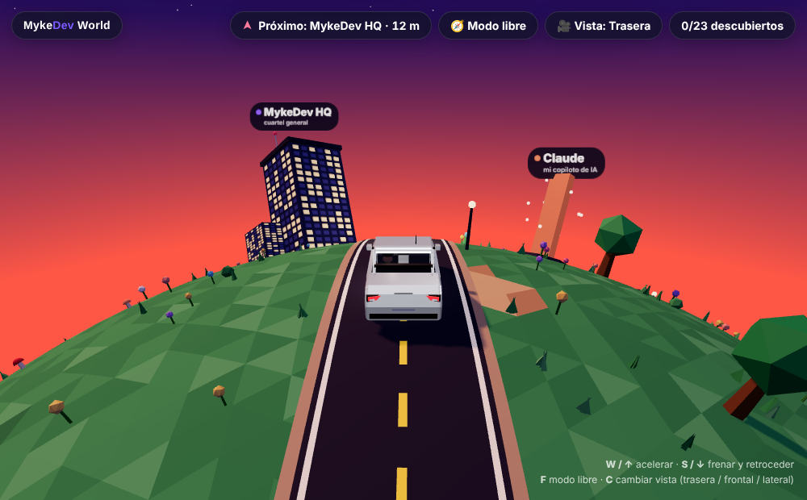

# MykeDev World 🌎🚗

Portfolio 3D interactivo de **Maikol Zapata** — Fullstack Product Engineer · Santiago, Chile.

Súbete al auto, recorre un pequeño planeta al atardecer y descubre mi stack, mis proyectos y mi trayectoria. Cada parada abre una tarjeta con información y enlaces.



## Qué hay en el planeta

- **Stack:** 12 tótems de cristal (React, Node.js, TypeScript, Next.js, PostgreSQL, Docker, HTML, CSS, GraphQL, Redis, AWS, Python). Los anillos que giran indican el nivel.
- **Proyectos:** Fast CV y Focus Poker, con enlaces a las apps.
- **Experiencia:** OTIC · CChC (con su grúa), PROYECTE y XBrein.
- **Formación:** INACAP — antes del código estudié vehículos, por eso este portfolio se recorre en auto.
- **Santiago, Chile:** cordillera con nieve, cascada, poza y un estero que llega a la calle (el auto salpica al pasar).
- **Claude:** mi copiloto de IA. Este mundo se construyó en colaboración con Claude.
- **Contacto:** email, GitHub, LinkedIn y CV.

## Controles

| Acción | Teclado | Móvil |
|---|---|---|
| Acelerar / frenar | `W` `S` o `↑` `↓` | ▲ ▼ |
| Girar (modo libre) | `A` `D` o `←` `→` | ◀ ▶ |
| Modo libre / volver al camino | `F` | ⚙️ Vista → Recorrido |
| Cambiar vista (trasera / frontal / lateral) | `C` | ⚙️ Vista → Cámara |
| Distancia de cámara (normal / lejana / aérea) | `V` | ⚙️ Vista → Distancia |
| Cielo (atardecer / 24 h / estrellado) | `L` | ⚙️ Vista → Cielo |

En **modo libre** puedes salir del camino: chocas solo con árboles, faroles y edificios; las flores y el pasto se aplastan (y se levantan solos).

## Cielos

- **Atardecer:** la puesta de sol de siempre.
- **24 h:** sol real. Calcula la altura del sol con la fecha, la hora y la ubicación (Santiago para Chile; otras zonas horarias, una ciudad de referencia), así que el amanecer y el atardecer cambian con la estación.
- **Estrellado:** noche despejada con vía láctea, luna y estrellas fugaces.

La elección de cielo y distancia se recuerda en el navegador.

## Tecnología

- [Three.js](https://threejs.org/) r160 (vía CDN, sin build)
- Un solo archivo `index.html`: geometría low-poly procedural, shaders de agua, instancing para la vegetación y partículas.
- El mundo gira bajo el auto: el auto nunca se mueve, el planeta rota con cuaterniones.

## Correr en local

```bash
npx serve .
# o
python3 -m http.server 8000
```

Luego abre `http://localhost:8000`.

## Publicar con GitHub Pages

Settings → Pages → *Deploy from a branch* → `main` / `root`. Queda en `https://zmykedev.github.io/mykedev-world/`.

---

Hecho por [Maikol Zapata](https://mykedev.cl) con Three.js y Claude.
